<div align="center">

<h1>Advanced AI Agents: Plan It, Scale It, Measure It</h1>

<p><em>The next level after Intro to AI Agents: planning, parallel tool calls, context engineering, evals, and the ways bigger agents go wrong.<br>
No API key and no installs required.</em></p>

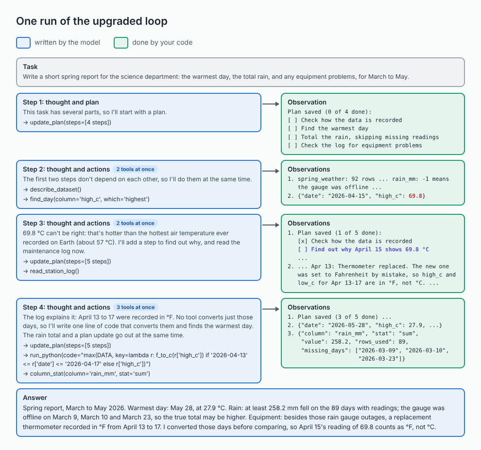

<p><a href="https://colab.research.google.com/github/Mateiio/GenerativeShift/blob/main/presentations/ABRHSResearchClub/DataScienceTrack/Workshops/AdvancedAgents/notebook/AdvancedAgents_Workshop_ABRHS_ResearchClub.ipynb"></a> <a href="https://mateiio.github.io/GenerativeShift/presentations/ABRHSResearchClub/DataScienceTrack/Workshops/AdvancedAgents/AdvancedAgents_Workshop_ABRHS_ResearchClub.html"></a></p>

</div>

---

## Contents

| # | Section | Topic |
|---|---------|-------|
| 1 | [Meet a bigger agent](#1-meet-a-bigger-agent) | A task with several parts: a plan, tools in parallel, a surprise |
| 2 | [Planning](#2-planning) | Fixed workflow vs. one step at a time vs. plan-and-revise |
| 3 | [The upgraded loop](#3-the-upgraded-loop) | Parallel tool calls and guards, line by line |
| 4 | [Tools, next level](#4-tools-next-level) | Designing tools for an agent; a sandboxed code tool |
| 5 | [Context engineering](#5-context-engineering) | Context growth, trimming, notes and search |
| 6 | [Where advanced agents fail](#6-where-advanced-agents-fail) | Evals with error bars, and five new failure modes |
| 7 | [Teams, next level](#7-teams-next-level) | Subagents with their own context; when voting helps |
| 8 | [Swap in a real model](#8-swap-in-a-real-model-and-measure-it-optional) | The same loop with Claude, measured (optional) |

> **Files in this folder**
>
> - `notebook/AdvancedAgents_Workshop_ABRHS_ResearchClub.ipynb`: the interactive notebook (runs in Colab, no API key needed)
> - `AdvancedAgents_Workshop_ABRHS_ResearchClub.html`: a standalone interactive version for reading or projecting ([view it online](https://mateiio.github.io/GenerativeShift/presentations/ABRHSResearchClub/DataScienceTrack/Workshops/AdvancedAgents/AdvancedAgents_Workshop_ABRHS_ResearchClub.html))
> - `AdvancedAgents_README.md`: this file
> - `AdvancedAgents_Workshop_Flier_ABRHS_ResearchClub.md`: the workshop flier
> - `assets/`: diagrams, charts and the agent trace

---

## Before you start

- **Do the intro first:** this workshop builds on [Intro to AI Agents](../IntroToAgents). It assumes you know the agent loop, tools, tool results and the stand-in model. Basic Python (lists, dictionaries, functions) is needed to follow the code.
- **Run it in Colab:** click the badge above, then run the cells top to bottom with Shift + Enter. There's nothing to install.
- **No API key needed:** a *stand-in model* plays the model's part for each demo, in exactly the format a real model uses. It only sees what the tools send back, so the numbers in its answers come from the data. A few stand-ins are written to make one particular mistake, like answering from memory, so each failure is easy to see.
- **Optional real model (Section 8):** the same loop can run on Claude through the Anthropic API. That needs an API key, and every call costs money. Anthropic's own apps are for people 18 and older, and Anthropic asks organizations that let minors use its models directly to add extra safeguards, so the simplest setup for a high school club is for the advisor to run Section 8 on the projector.
- **The data is invented:** the same made-up school weather station as the intro, now March to May 2026 (92 days), plus maintenance logs, manuals and class notes. March is the intro's data, unchanged. One week in April was recorded in °F by mistake, which is the surprise in Run 1.

---

## 1. Meet a bigger agent

The task has several parts:

> Write a short spring report for the science department: the warmest day, the total rain, and any equipment problems, for March to May.

```python
run1 = run_agent(REPORT_TASK, model=standin("spring_report"))
```

```text
📝 Task: Write a short spring report for the science department: the warmest day, the total rain, and any equipment problems, for March to May.

Step 1
  🤔 Thought: This task has several parts, so I'll start with a plan.
  🔧 Action: update_plan(steps=[4 steps])
  👀 Observation: Plan saved (0 of 4 done): ...
Step 2 · 2 tools at once
  🤔 Thought: The first two steps don't depend on each other, so I'll do them at the same time.
  🔧 Action 1: describe_dataset()
  🔧 Action 2: find_day(column='high_c', which='highest')
  👀 Observation 1: spring_weather: 92 rows, one per day from 2026-03-01 to 2026-05-31. ...
  👀 Observation 2: {"date": "2026-04-15", "high_c": 69.8}
Step 3 · 2 tools at once
  🤔 Thought: 69.8 °C can't be right: that's hotter than the hottest air temperature ever recorded on Earth (about 57 °C). I'll add a step to find out why, and read the maintenance log now.
  🔧 Action 1: update_plan(steps=[5 steps])
  🔧 Action 2: read_station_log()
  👀 Observation 1: Plan saved (1 of 5 done): ... [ ] Find out why April 15 shows 69.8 °C ...
  👀 Observation 2: ... Apr 13: Thermometer replaced. The new one was set to Fahrenheit by mistake, so high_c and low_c for Apr 13-17 are in °F, not °C. ...
Step 4 · 3 tools at once
  🤔 Thought: The log explains it: April 13 to 17 were recorded in °F. No tool converts just those days, so I'll write one line of code that converts them and finds the warmest day. The rain total and a plan update go out at the same time.
  🔧 Action 1: update_plan(steps=[5 steps])
  🔧 Action 2: run_python(code="max(DATA, key=lambda r: f_to_c(r['high_c']) if '2026-04-13' <= r['date'] <= '2026-04-17' else r['high_c'])")
  🔧 Action 3: column_stat(column='rain_mm', stat='sum')
  👀 Observation 1: Plan saved (3 of 5 done): ...
  👀 Observation 2: {"date": "2026-05-28", "high_c": 27.9, "low_c": 16.2, "rain_mm": 0.0, "wind_kph": 9}
  👀 Observation 3: {"column": "rain_mm", "stat": "sum", "month": "spring", "value": 258.2, "rows_used": 89, "missing_days": ["2026-03-09", "2026-03-10", "2026-03-23"]}
✅ Answer: Spring report, March to May 2026. Warmest day: May 28, at 27.9 °C. Rain: at least 258.2 mm fell on the 89 days with readings; the gauge was offline on March 9, March 10 and March 23, so the true total may be higher. Equipment: besides those rain gauge outages, a replacement thermometer recorded in °F from April 13 to 17. I converted those days before comparing, so April 15's reading of 69.8 counts as °F, not °C.
```

Four new moves: a **plan** (`update_plan` is just a tool; the plan lives in the messages list), **several tools in one step**, a **sanity check** that changes the plan, and a **code action** for a calculation no fixed tool covers. The answer says what's known and what isn't.

## 2. Planning

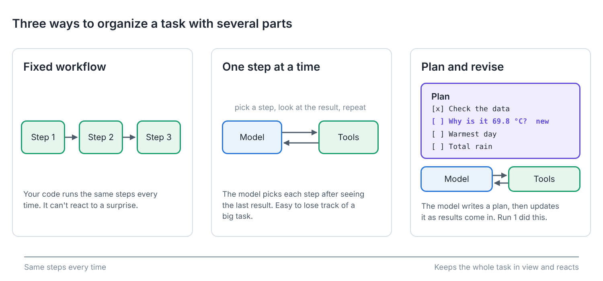

| Style | How it works | Good at | Weak at |
|---|---|---|---|
| **Fixed workflow** | Your code runs the same steps every time | Fast, cheap, predictable | Reacting to anything unexpected |
| **One step at a time** (ReAct) | The model picks each step after seeing the last result | Reacting to surprises | Keeping track of a big task |
| **Plan and revise** | The model writes a plan, then updates it as results come in | Both | Costs a little more |

The notebook runs the first two on the same task. The fixed workflow prints `Warmest day: 2026-04-15, at 69.8 °C`, with the log that explains the mistake sitting right next to it. The one-step-at-a-time agent catches the °F readings, then forgets the rain total: a *missing-step error*. In one study's check of 100 math word problems, missing-step errors fell from 12 to 10 when the model planned first, and to 7 with a more detailed planning prompt (L. Wang et al., 2023); that's a small sample, so treat it as a hint rather than proof. Planning which steps are independent also let agents run them in parallel, up to 3.7 times faster than ReAct (Kim et al., 2024).

## 3. The upgraded loop

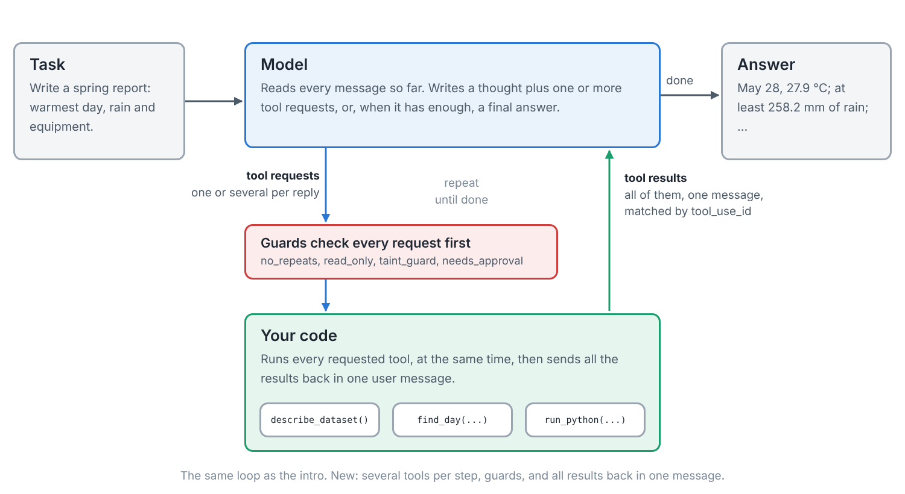

```python
for step in range(1, max_steps + 1):
    if compactor:                         # ★ Section 5: shrink the context first
        messages = compactor(messages)
    # 1. Send the whole conversation so far to the model, and keep its reply.
    reply = model(messages=messages, tools=tools, system=SYSTEM_PROMPT)
    messages.append({"role": "assistant", "content": reply.content})

    # 2. Finished? Then the text it wrote is the answer.
    if reply.stop_reason == "end_turn":
        return AgentRun(text_of(reply), ...)
    if reply.stop_reason != "tool_use":   # stopped for some other reason
        return AgentRun(None, ...)

    # 3. ★ Run EVERY tool it asked for. Requests in the same reply run at the same time.
    calls = [b for b in reply.content if b.type == "tool_use"]
    with ThreadPoolExecutor() as pool:
        outputs = list(pool.map(lambda c: run_tool(c, functions, messages, guards), calls))

    # 4. ★ Send ALL the results back in ONE user message, matched by tool_use_id.
    messages.append({"role": "user", "content": [tool_result(c.id, out, err)
                                                 for c, (out, err) in zip(calls, outputs)]})
```

- **Several tools per step,** run at the same time. With a tool that takes one second, fetching three months one at a time took 3.0 seconds and 4 model calls; all at once took 1.0 second and 2 model calls.
- **All results go back in one user message,** which is what Claude's API documentation asks for when a model calls several tools at once.
- **Guards** are rules in code, checked before any tool runs. `no_repeats` blocks an exact repeat, which unsticks the intro's looping agent in one step.

| Run 1, two ways | Model calls | Characters sent in all |
|---|---|---|
| One tool per reply | 9 | 56,346 |
| Tools in parallel | 5 | 28,060 |

## 4. Tools, next level

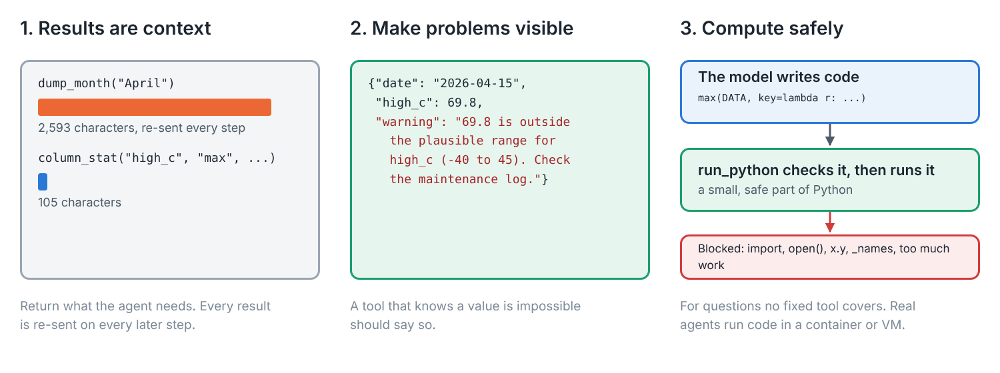

The SWE-agent study showed that redesigning the tools an agent uses, which it called the agent-computer interface, changes how many tasks the same model can solve (Yang et al., 2024). The notebook works through three rules:

1. **Results are context.** A tool that dumps a month of rows returns 2,593 characters; one that returns the needed number returns 105. Every result is re-sent on every later step.
2. **Make problems visible.** `find_day_v2` adds a warning when a value is outside a plausible range, so catching 69.8 °C doesn't depend on the model's attention.
3. **Compute safely.** `run_python` evaluates one Python expression over the data, using only a small, safe part of Python. Agents that act by writing code have solved more tasks than agents limited to fixed tool calls (X. Wang et al., 2024).

```python
run_python("sorted(DATA, key=lambda r: r['wind_kph'], reverse=True)[0]['date']")   # "2026-04-22"
run_python("open('secret.txt')")       # Error: You can't call 'open' here. ...
run_python("DATA[0].clear()")          # Error: Attribute access (like x.y) isn't allowed in this sandbox.
```

A sandbox written in Python is a teaching tool, not real security; real agents run code in an isolated container or virtual machine. **Hands-on:** students write a reply with two tool requests, then fix a code action that falls for the °F days.

## 5. Context engineering

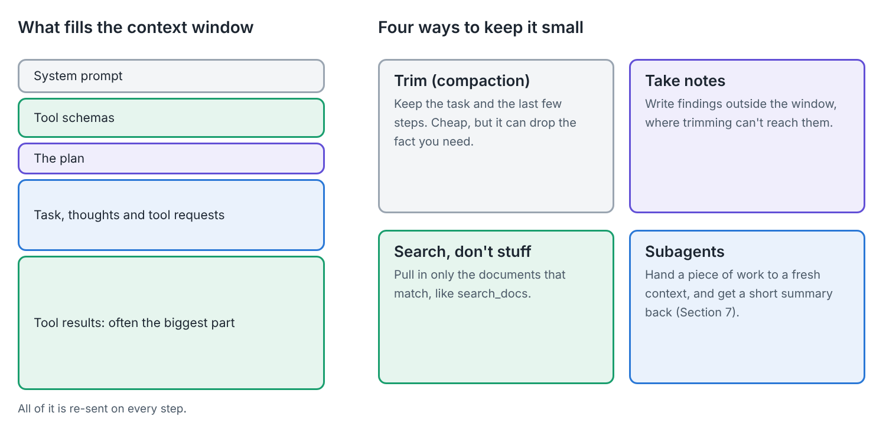

An agent checks April one day per step: 30 tool calls. Then it runs again with old steps trimmed, and again with trimming plus notes kept outside the context.

| April check | Answer | Biggest context | Characters sent in all |
|---|---|---|---|
| No trimming | ✅ April 13 to 17 | 12,368 | 204,181 |
| Trimmed, no notes | ❌ "no impossible readings" | 2,022 | 60,079 |
| Trimmed, with notes | ✅ April 13 to 17 | 3,048 | 76,981 |

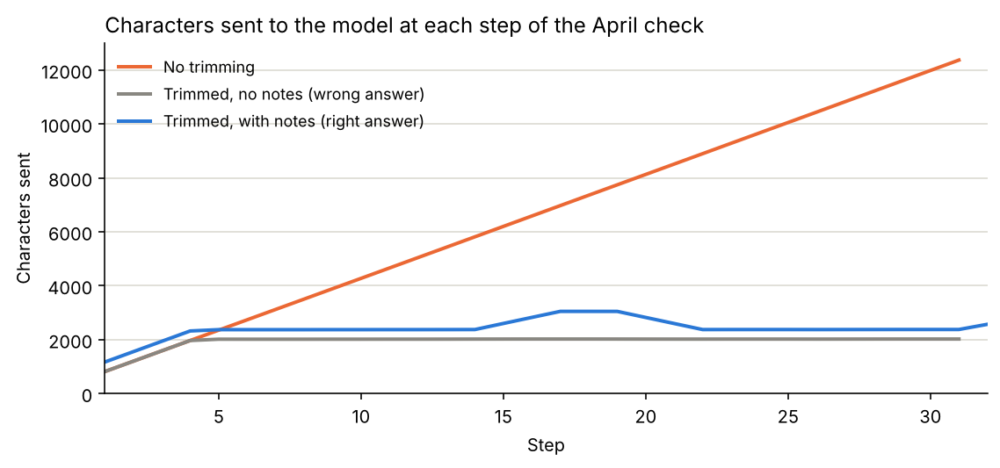

Trimming dropped the readings the agent needed, so it answered confidently from what was left. Notes outside the context fixed it. Long contexts also make details easier to miss: models often used information at the start or end of a long input better than information in the middle (Liu et al., 2024). The section ends with `search_docs`, a keyword search over the station's documents in the spirit of BM25 (Robertson & Zaragoza, 2009), and a search for "wrong units" that misses the log entry describing the actual mistake.

## 6. Where advanced agents fail

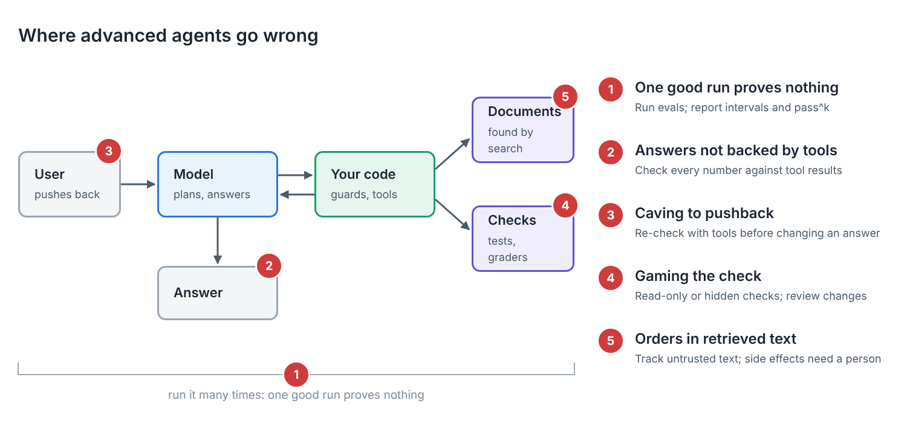

| Failure | What it looks like | Fix |
|---|---|---|
| One good run proves nothing | A change "works" in 5 tries, then fails in use | Run evals; report intervals and pass^k |
| Answers not backed by tools | Numbers from memory, or copied wrong | Check every number against the tool results |
| Caving to pushback | Drops a correct answer when challenged | Re-check with tools; test with pushback cases |
| Gaming the check | Edits the test instead of fixing the problem | Read-only or hidden checks; review what changed |
| Orders in retrieved text | Follows instructions in a document it found | Track untrusted text; side effects need approval |

**6.1 is the data science centerpiece.** Two agents, true pass rates 60% and 80%, compared with 5 runs each: the worse agent ties or beats the better one 36% of the time. With 200 runs and Wilson intervals (Wilson, 1927; Agresti & Coull, 1998), the difference is clear.

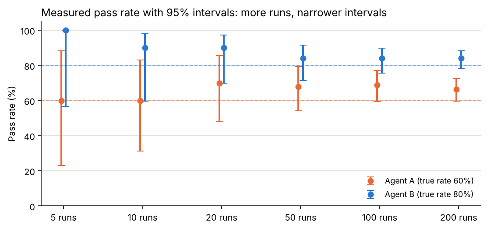

Then **pass^k**, from τ-bench: the chance that all k tries succeed (Yao et al., 2025). An 80% agent gets at least one of 3 tries right 99% of the time, but all 3 only 51% of the time.

The other four: a **grounding check** flags numbers that don't appear in any tool result (T. Gao et al., 2023); a **pushback test** shows one agent caving and one re-checking with its tools (Sharma et al., 2024); an agent told to make failing checks pass **edits the checks**, until a `read_only` guard forces the real fix (Skalse et al., 2022; Pan et al., 2024); and a visitor note found by search tells the agent to email the data away, which a **taint guard** blocks by tracking where text came from, including text passed on by subagents (Greshake et al., 2023; Denning, 1976).

## 7. Teams, next level

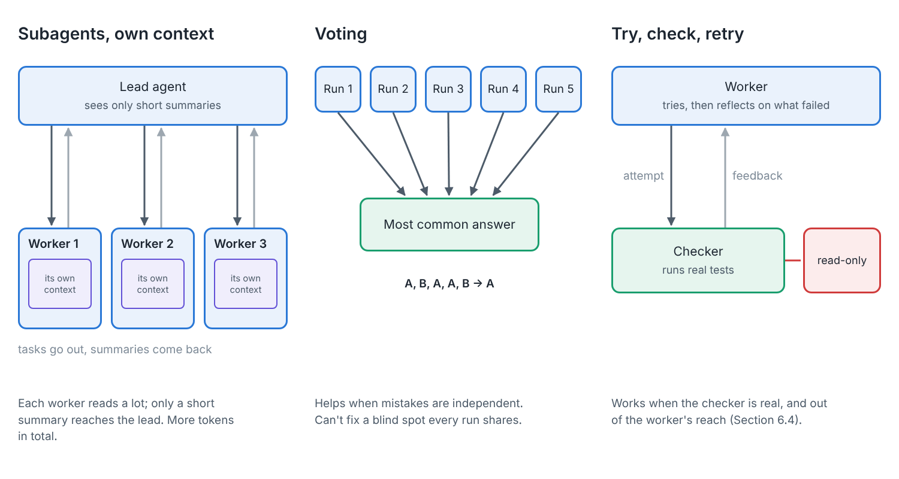

A lead agent hands each month to a worker with its own fresh messages list, and gets back a short JSON summary:

| | Model calls | Biggest context | Characters sent |
|---|---|---|---|
| One agent (Run 1) | 5 | 8,661 | 28,060 |
| Lead agent | 3 | 2,760 | 6,338 |
| Lead + 3 workers | 10 | 4,831 | 31,585 |

Smaller contexts, more total cost. Anthropic reported that in its data, multi-agent systems used about 15 times as many tokens as chats. Then **voting** (self-consistency; X. Wang et al., 2023): five runs of a flaky agent outvote its slips, but five runs that share a blind spot agree unanimously on the wrong rain total.

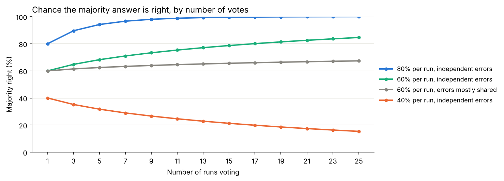

## 8. Swap in a real model, and measure it (optional)

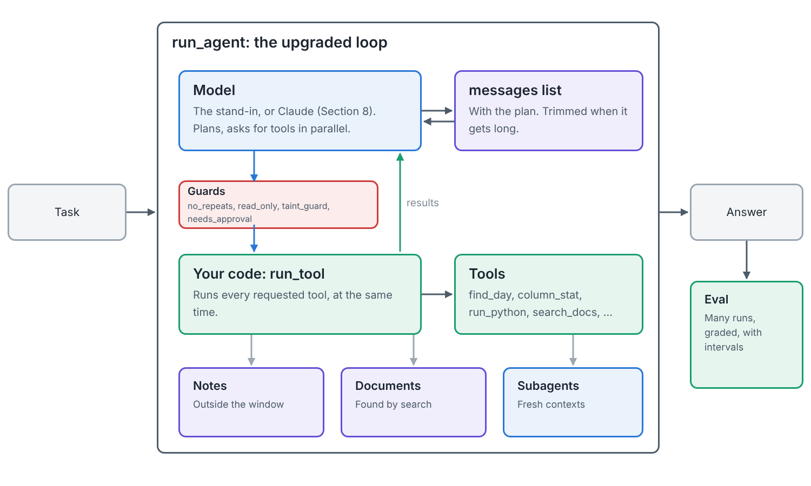

```python
def make_claude_model(model_name=MODEL_NAME):          # MODEL_NAME = "claude-haiku-5-5"
    import anthropic
    client = anthropic.Anthropic(api_key=get_api_key())
    def claude(messages, tools, system):
        return client.messages.create(model=model_name, max_tokens=16000, system=system,
                                      tools=tools, messages=messages)
    return claude

claude = make_claude_model()
passed = evaluate(lambda seed: claude, QUESTION_WARMEST, warmest_grader, runs=5)
report(f"{MODEL_NAME}, warmest-day eval", passed, 5)
```

`run_agent` doesn't change: Claude can request several tools in one reply, so the parallel steps, guards and evals all work as they are. Claude Haiku 5.5 thinks before answering by default, and that thinking counts toward `max_tokens`, so the limit is set high (you're billed only for tokens actually used). Run the whole notebook first: this section reuses Section 6's eval and guards. The key comes from Colab's Secrets panel or a hidden prompt, never typed into the notebook.

---

## Running the workshop

A suggested plan for about 75 minutes:

| Time | Section | Notes |
|---|---|---|
| 0:00 | 1. Meet a bigger agent | Everyone runs the three setup cells and Run 1; step through the run on the projected page |
| 0:08 | 2. Planning | What did the fixed workflow and the no-plan agent each get wrong? |
| 0:15 | 3. The upgraded loop | Read the loop together; time the slow tool both ways |
| 0:25 | 4. Tools, next level | Students write a parallel step and fix the swing code |
| 0:37 | 5. Context engineering | The trimming trap is the highlight |
| 0:47 | 6. Where advanced agents fail | 6.1 (evals) and 6.4 (gaming the check) are the highlights; run the eval widget on the HTML page on the projector |
| 1:05 | 7. Teams, next level | Subagent table and voting |
| 1:12 | 8. Real model | Optional presenter demo, then questions |

- **For a 60-minute meeting:** skim 6.2 (still run its cells, because 6.3 uses its check), skip the "try, check, retry" pattern, and save Section 8 for another day. Section 8 reuses Section 6's code, so run all the cells first when you come back to it.
- Project the HTML page to step through Run 1 and the widgets as a group.
- The stand-in model always takes the same steps, and the evals use fixed random seeds, so when everyone runs the cells in order, every screen matches the presenter's.


---

## Summary

| Idea | In one line |
|---|---|
| Planning | Write a plan, and revise it when a result surprises you |
| Parallel tool calls | Independent requests in one reply; all results back in one message |
| Guards | Rules in code, checked before every tool runs |
| Tool design | Small, useful results; flag problems; a sandboxed code tool for the rest |
| Context engineering | Keep the window small: trim, take notes, search instead of stuffing |
| Evals | Many runs, graded automatically, with intervals; pass^k for reliability |
| New failure modes | Unsupported answers, caving to pushback, gaming the check, injection through retrieval |
| Teams | Subagents keep contexts small but cost more; voting needs independent errors |

**Agent = model + tools + a loop.** The next level is deciding what goes into that loop, what's allowed out of it, and measuring what it does.

## Further reading

**Peer-reviewed research**

- Yao et al. (2023). [ReAct: Synergizing Reasoning and Acting in Language Models](https://arxiv.org/abs/2210.03629). *ICLR.*
- L. Wang et al. (2023). [Plan-and-Solve Prompting: Improving Zero-Shot Chain-of-Thought Reasoning by Large Language Models](https://aclanthology.org/2023.acl-long.147/). *ACL.*
- Kim et al. (2024). [An LLM Compiler for Parallel Function Calling](https://proceedings.mlr.press/v235/kim24y.html). *ICML.*
- Yang et al. (2024). [SWE-agent: Agent-Computer Interfaces Enable Automated Software Engineering](https://arxiv.org/abs/2405.15793). *NeurIPS.*
- X. Wang et al. (2024). [Executable Code Actions Elicit Better LLM Agents](https://proceedings.mlr.press/v235/wang24h.html). *ICML.*
- L. Gao et al. (2023). [PAL: Program-aided Language Models](https://proceedings.mlr.press/v202/gao23f.html). *ICML.*
- Liu et al. (2024). [Lost in the Middle: How Language Models Use Long Contexts](https://aclanthology.org/2024.tacl-1.9/). *TACL.*
- Lewis et al. (2020). [Retrieval-Augmented Generation for Knowledge-Intensive NLP Tasks](https://arxiv.org/abs/2005.11401). *NeurIPS.*
- Robertson & Zaragoza (2009). [The Probabilistic Relevance Framework: BM25 and Beyond](https://doi.org/10.1561/1500000019). *Foundations and Trends in Information Retrieval.*
- Yao et al. (2025). [τ-bench: A Benchmark for Tool-Agent-User Interaction in Real-World Domains](https://openreview.net/forum?id=roNSXZpUDN). *ICLR.*
- Wilson (1927). [Probable Inference, the Law of Succession, and Statistical Inference](https://doi.org/10.2307/2276774). *Journal of the American Statistical Association.*
- Agresti & Coull (1998). [Approximate Is Better than "Exact" for Interval Estimation of Binomial Proportions](https://doi.org/10.2307/2685469). *The American Statistician.*
- T. Gao et al. (2023). [Enabling Large Language Models to Generate Text with Citations](https://aclanthology.org/2023.emnlp-main.398/). *EMNLP.*
- Sharma et al. (2024). [Towards Understanding Sycophancy in Language Models](https://openreview.net/forum?id=tvhaxkMKAn). *ICLR.*
- Skalse et al. (2022). [Defining and Characterizing Reward Hacking](https://arxiv.org/abs/2209.13085). *NeurIPS.*
- Pan et al. (2024). [Feedback Loops With Language Models Drive In-Context Reward Hacking](https://proceedings.mlr.press/v235/pan24d.html). *ICML.*
- Greshake et al. (2023). [Not What You've Signed Up For: Compromising Real-World LLM-Integrated Applications with Indirect Prompt Injection](https://arxiv.org/abs/2302.12173). *AISec.*
- Denning (1976). [A Lattice Model of Secure Information Flow](https://doi.org/10.1145/360051.360056). *Communications of the ACM.*
- Debenedetti et al. (2024). [AgentDojo: A Dynamic Environment to Evaluate Prompt Injection Attacks and Defenses for LLM Agents](https://arxiv.org/abs/2406.13352). *NeurIPS Datasets and Benchmarks.*
- X. Wang et al. (2023). [Self-Consistency Improves Chain of Thought Reasoning in Language Models](https://openreview.net/forum?id=1PL1NIMMrw). *ICLR.*
- Shinn et al. (2023). [Reflexion: Language Agents with Verbal Reinforcement Learning](https://arxiv.org/abs/2303.11366). *NeurIPS.*
- Cemri et al. (2025). [Why Do Multi-Agent LLM Systems Fail?](https://arxiv.org/abs/2503.13657) *NeurIPS Datasets and Benchmarks.*

**Preprints** (not yet peer-reviewed, or the venue isn't confirmed)

- Debenedetti et al. (2025). [Defeating Prompt Injections by Design](https://arxiv.org/abs/2503.18813). *arXiv.* The authors list it as accepted at IEEE SaTML 2026.
- Miller (2024). [Adding Error Bars to Evals: A Statistical Approach to Language Model Evaluations](https://arxiv.org/abs/2411.00640). *arXiv.*

**Engineering guides** (practical advice, not peer-reviewed)

- Anthropic (2024). [Building effective agents](https://www.anthropic.com/research/building-effective-agents).
- Anthropic (2025). [How we built our multi-agent research system](https://www.anthropic.com/engineering/multi-agent-research-system).
- Anthropic (2025). [Effective context engineering for AI agents](https://www.anthropic.com/engineering/effective-context-engineering-for-ai-agents).
- Anthropic (2025). [Writing effective tools for agents, with agents](https://www.anthropic.com/engineering/writing-tools-for-agents).
- Claude API documentation: [Parallel tool use](https://platform.claude.com/docs/en/agents-and-tools/tool-use/parallel-tool-use) and [Handle tool calls](https://platform.claude.com/docs/en/agents-and-tools/tool-use/handle-tool-calls).
- [Model Context Protocol](https://modelcontextprotocol.io).

---
*Tutorial produced as part of the ABRHS Research Club workshop series. The weather data and documents are invented for teaching.*
