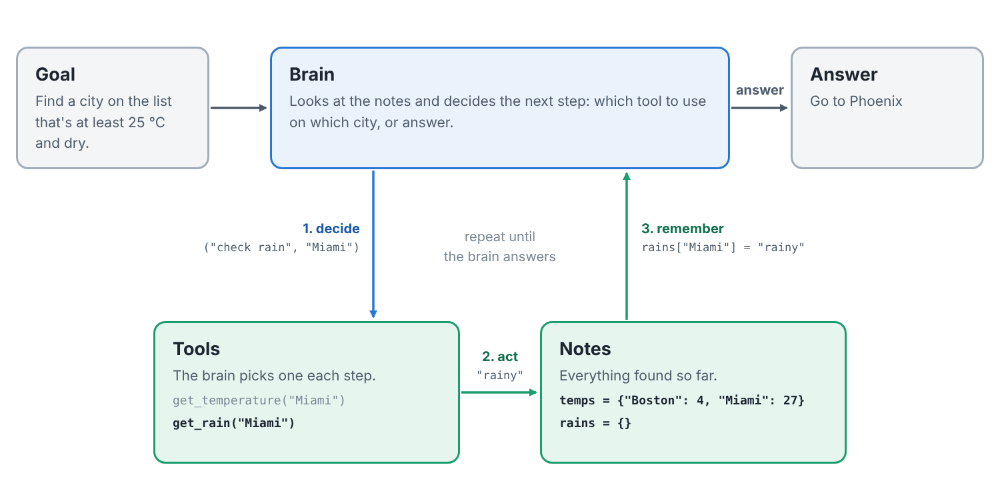

<div align="center">

<h1>Advanced AI Agents: Pick the Right Tool</h1>

<p><em>The next step after Intro to AI Agents: give the agent a second tool and watch it pick which one to use, in about 30 lines of plain Python.<br>
No AI model, no API key and no installs required.</em></p>



<p><a href="https://colab.research.google.com/github/Mateiio/GenerativeShift/blob/main/presentations/ABRHSResearchClub/DataScienceTrack/Workshops/AdvancedAgents/notebook/AdvancedAgents_Workshop_ABRHS_ResearchClub.ipynb"></a> <a href="https://mateiio.github.io/GenerativeShift/presentations/ABRHSResearchClub/DataScienceTrack/Workshops/AdvancedAgents/AdvancedAgents_Workshop_ABRHS_ResearchClub.html"></a></p>

</div>

---

> **Do the intro first.** This workshop builds on the 19-line agent from [Intro to AI Agents](../IntroToAgents).

## Contents

| # | Section | Topic |
|---|---------|-------|
| 1 | [A harder goal](#1-a-harder-goal) | Why one tool isn't enough anymore |
| 2 | [The agent](#2-the-agent) | The whole two-tool agent in one cell |
| 3 | [Try it yourself](#3-try-it-yourself) | Change it, then add a third tool |
| 4 | [Tools in real AI agents](#4-tools-in-real-ai-agents) | How a language model picks its tools |

> **Files in this folder**
>
> - `notebook/AdvancedAgents_Workshop_ABRHS_ResearchClub.ipynb`: the notebook (runs in Colab, nothing to install)
> - `AdvancedAgents_Workshop_ABRHS_ResearchClub.html`: a standalone version for reading or projecting ([view it online](https://mateiio.github.io/GenerativeShift/presentations/ABRHSResearchClub/DataScienceTrack/Workshops/AdvancedAgents/AdvancedAgents_Workshop_ABRHS_ResearchClub.html))
> - `AdvancedAgents_README.md`: this file
> - `AdvancedAgents_Workshop_Flier_ABRHS_ResearchClub.md`: the workshop flier
> - `assets/`: the two-tool loop diagram

---

## 1. A harder goal

The new goal: **find a city on our list that's at least 25 °C and dry.** The temperature alone can't answer that, so the agent gets a second tool that says whether a city is rainy or dry. Each step, the brain now decides which city to look at and which tool to use on it.

## 2. The agent

```python
cities = ["Boston", "Miami", "Phoenix", "Denver"]
temperatures = {"Boston": 4, "Miami": 27, "Phoenix": 31, "Denver": -3}
rain = {"Boston": "dry", "Miami": "rainy", "Phoenix": "dry", "Denver": "dry"}

def get_temperature(city):         # TOOL 1: looks up the temperature
    return temperatures[city]

def get_rain(city):                # TOOL 2: looks up rainy or dry
    return rain[city]

def brain(temps, rains):           # BRAIN: picks a tool, or answers
    for city in cities:
        if city not in temps:
            return "check temperature", city
        if temps[city] >= 25 and city not in rains:
            return "check rain", city
        if temps[city] >= 25 and rains[city] == "dry":
            return "answer", city

temps = {}                         # NOTES: temperatures found so far
rains = {}                         # NOTES: rain found so far
while True:                        # LOOP: decide, act, remember, repeat
    action, city = brain(temps, rains)
    if action == "answer":
        print("Go to", city)
        break
    if action == "check temperature":
        temps[city] = get_temperature(city)
        print(city, "is", temps[city], "°C")
    if action == "check rain":
        rains[city] = get_rain(city)
        print(city, "is", rains[city])
```

```text
Boston is 4 °C
Miami is 27 °C
Miami is rainy
Phoenix is 31 °C
Phoenix is dry
Go to Phoenix
```

The agent checks the rain only in Miami and Phoenix, the two cities warm enough to matter. It never asks about rain in Boston, and it never looks at Denver.

| # | Part | In the code |
|---|---|---|
| 1 | Tools | `get_temperature` and `get_rain`, one question each |
| 2 | Brain | Checks a city's temperature first, the rain only if it's warm, and answers when a city is warm and dry |
| 3 | Notes | One dictionary per tool: `temps` and `rains` |
| 4 | Loop | Runs whichever tool the brain picked and records the result |

## 3. Try it yourself

- Make Miami dry, and the agent stops at Miami.
- Make Boston 30 °C, and it never checks Miami at all.
- Challenge: add a third tool, `get_wind(city)`, so the beach city also has to be calm.

## 4. Tools in real AI agents

A language model learns about its tools from short descriptions, like "get_rain: tells you whether a city is rainy or dry", and picks one the same way: from the goal and what's already in the notes. Real agents often have dozens of tools, and picking the right one is a big part of what makes them useful.

---

## Running the workshop

A suggested plan for about 25 minutes:

| # | Time | Section | Notes |
|---|---|---|---|
| 1 | 0:00 | 1. A harder goal | Ask why the Intro agent can't answer the new goal |
| 2 | 0:05 | 2. The agent | Step through the run on the projector, then everyone runs the cell |
| 3 | 0:12 | 3. Try it yourself | The third-tool challenge is the main activity |
| 4 | 0:22 | 4. Tools in real AI agents | How a model picks tools, then questions |

- On the projector, use the HTML page's **Next step** button to show which tool the brain picks at each step.

---

## Further reading

- Anthropic (2024). [Building effective agents](https://www.anthropic.com/research/building-effective-agents). When to use an agent, and the patterns real ones are built from.
- Yao et al. (2023). [ReAct: Synergizing Reasoning and Acting in Language Models](https://arxiv.org/abs/2210.03629). *ICLR.* The decide, act, observe loop with a language model as the brain.

---
*Tutorial produced as part of the ABRHS Research Club workshop series. The weather is invented for teaching.*
