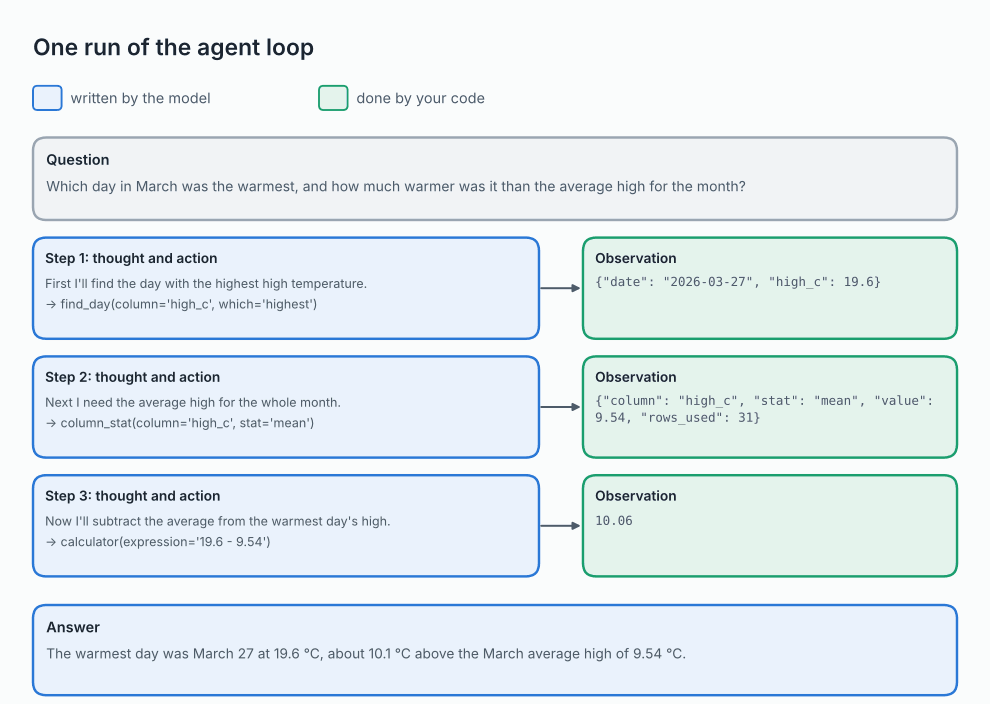
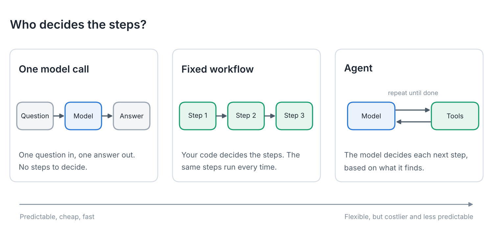
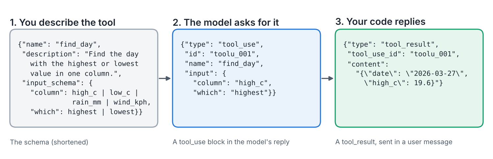
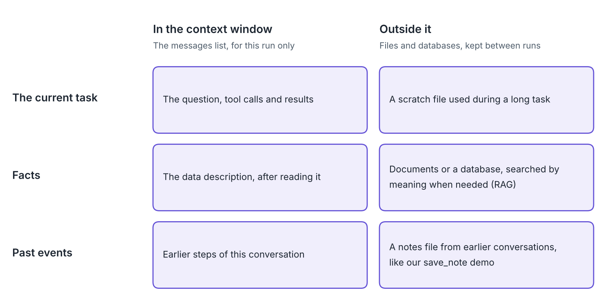
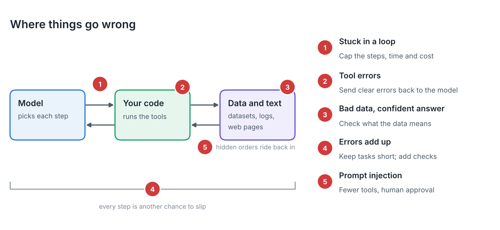
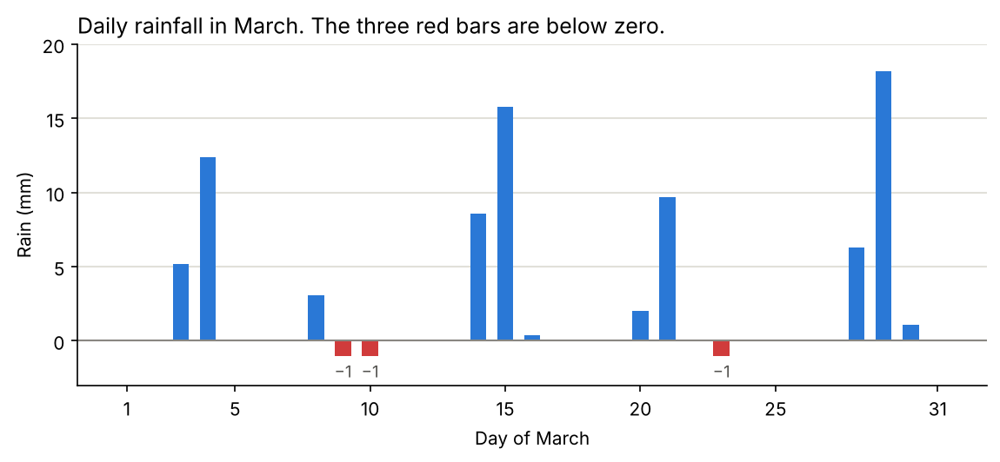
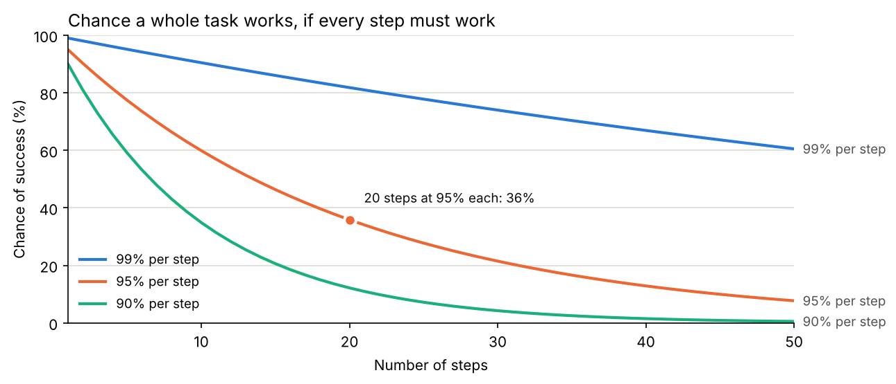
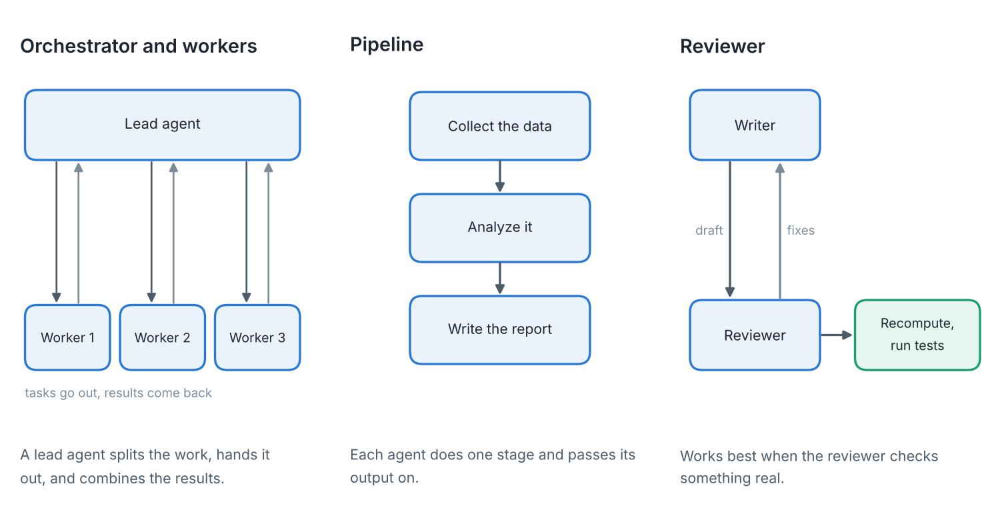
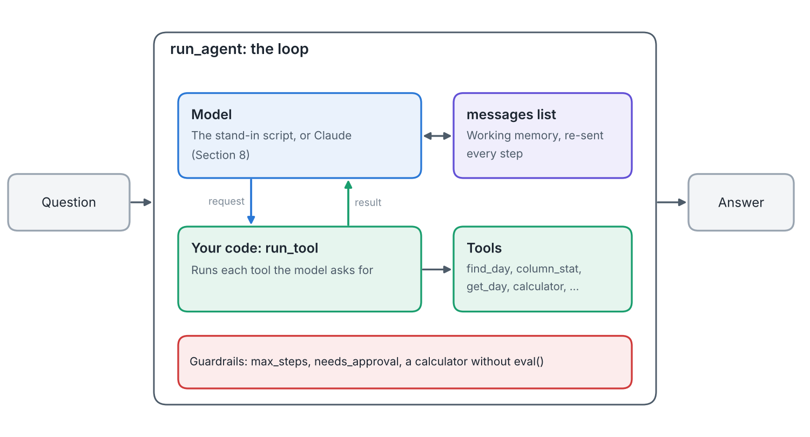

<div align="center">

<h1>Intro to AI Agents: Build One, Run It, Break It</h1>

<p><em>A hands-on introduction to AI agents: what they are, how the loop inside them works, and where they go wrong.<br>
No prior AI knowledge, no API key and no installs required.</em></p>



<p><a href="https://colab.research.google.com/github/Mateiio/GenerativeShift/blob/main/presentations/ABRHSResearchClub/DataScienceTrack/Workshops/IntroToAgents/notebook/IntroToAgents_Workshop_ABRHS_ResearchClub.ipynb"></a> <a href="https://mateiio.github.io/GenerativeShift/presentations/ABRHSResearchClub/DataScienceTrack/Workshops/IntroToAgents/IntroToAgents_Workshop_ABRHS_ResearchClub.html"></a></p>

</div>

---

## Contents

| # | Section | Topic |
|---|---------|-------|
| 1 | [Meet an agent](#1-meet-an-agent) | Run a working agent on data no AI has seen |
| 2 | [What makes it an agent?](#2-what-makes-it-an-agent) | One model call vs. a fixed workflow vs. an agent |
| 3 | [The loop, line by line](#3-the-loop-line-by-line) | The ReAct loop and the transcript it builds |
| 4 | [Tools](#4-tools-giving-the-model-hands) | Function plus schema; play the model yourself |
| 5 | [Memory](#5-memory-what-does-the-agent-remember) | The messages list, and memory that survives |
| 6 | [Where agents fail](#6-where-agents-fail) | Five failure modes and their fixes |
| 7 | [Teams of agents](#7-teams-of-agents) | Orchestrator, pipeline and reviewer patterns |
| 8 | [Swap in a real model](#8-swap-in-a-real-model-optional) | The same loop with Claude (optional) |

> **Files in this folder**
>
> - `notebook/IntroToAgents_Workshop_ABRHS_ResearchClub.ipynb`: the interactive notebook (runs in Colab, no API key needed)
> - `IntroToAgents_Workshop_ABRHS_ResearchClub.html`: a standalone interactive version for reading or projecting ([view it online](https://mateiio.github.io/GenerativeShift/presentations/ABRHSResearchClub/DataScienceTrack/Workshops/IntroToAgents/IntroToAgents_Workshop_ABRHS_ResearchClub.html))
> - `IntroToAgents_README.md`: this file
> - `IntroToAgents_Workshop_Flier_ABRHS_ResearchClub.md`: the workshop flier
> - `assets/`: diagrams, charts and the agent trace

---

## Before you start

- **Run it in Colab:** click the badge above, then run the cells top to bottom with Shift + Enter. There's nothing to install.
- **No API key needed:** a *stand-in model* plays the model's part for each demo. It's a short script that talks to the agent loop in exactly the format a real model uses, and it only sees what the tools send back, so every number in its answers comes from the data.
- **Optional real model (Section 8):** the same loop can run on Claude through the Anthropic API. That needs an API key, and every call costs money. Anthropic's own apps are for people 18 and older, and Anthropic asks organizations that let minors use its models directly to add extra safeguards, so the simplest setup for a high school club is for the advisor to run Section 8 on the projector.
- **The data is invented:** 31 days of readings from a made-up school weather station. That's the point: no AI model has seen it, so the agent has to use tools.

---

## 1. Meet an agent

The first thing you do is run one. The question:

> Which day in March was the warmest, and how much warmer was it than the average high for the month?

```python
run1 = run_agent(QUESTION_WARMEST, model=standin("warmest_day"))
```

```text
❓ Question: Which day in March was the warmest, and how much warmer was it than the average high for the month?

Step 1
  🤔 Thought: First I'll find the day with the highest high temperature.
  🔧 Action: find_day(column='high_c', which='highest')
  👀 Observation: {"date": "2026-03-27", "high_c": 19.6}
Step 2
  🤔 Thought: Next I need the average high for the whole month.
  🔧 Action: column_stat(column='high_c', stat='mean')
  👀 Observation: {"column": "high_c", "stat": "mean", "value": 9.54, "rows_used": 31}
Step 3
  🤔 Thought: Now I'll subtract the average from the warmest day's high.
  🔧 Action: calculator(expression='19.6 - 9.54')
  👀 Observation: 10.06
✅ Answer: The warmest day was March 27 at 19.6 °C, about 10.1 °C above the March average high of 9.54 °C.
```

Each step has a **thought** (the model writes what it'll do next), an **action** (it asks for a tool by name, with inputs) and an **observation** (your code runs the tool and hands back the result). The model never touches the data. It only writes text.

## 2. What makes it an agent?



| | Who decides the steps? |
|---|---|
| **One model call** | Nobody: one question in, one answer out |
| **Fixed workflow** | You do, in your code |
| **Agent** | The model does, one step at a time, based on what it finds |

If you already know the steps, write them yourself. The warmest-day question always takes the same three steps, so plain Python answers it with no model at all. Agents earn their cost when the next step depends on what you find.

> "Agent" here isn't the reinforcement-learning kind from the Q-Learning workshop. It's a language model using tools in a loop.

## 3. The loop, line by line


The heart of `run_agent`, following the ReAct pattern (Yao et al., 2023):

```python
for step in range(1, max_steps + 1):
    # 1. Send the whole conversation so far to the model, and keep its reply.
    reply = model(messages=messages, tools=tools, system=SYSTEM_PROMPT)
    messages.append({"role": "assistant", "content": reply.content})

    # 2. Finished? Then the text it wrote is the answer.
    if reply.stop_reason == "end_turn":
        return AgentRun(text_of(reply), messages, step)
    if reply.stop_reason != "tool_use":          # stopped for some other reason
        return AgentRun(None, messages, step)

    # 3. Otherwise, run every tool it asked for...
    results = []
    for block in reply.content:
        if block.type == "tool_use":
            output, is_error = run_tool(block.name, block.input, functions, needs_approval)
            results.append(tool_result(block.id, output, is_error))

    # 4. ...and send the results back as the next message. Then go around again.
    messages.append({"role": "user", "content": results})
```

- `messages` is the whole conversation, and the loop re-sends all of it every step.
- The model only returns text. `run_tool` is where real work happens.
- The loop stops on `end_turn`, checks for other stop reasons, and `max_steps` stops runaway loops.
- Tool results go back in a **user** message, matched to their request by `tool_use_id`, in the same format as Claude's API.

## 4. Tools: giving the model hands



A tool is a Python function plus a schema. The model only ever sees the schema:

```json
{
  "name": "find_day",
  "description": "Find the day with the highest or lowest value in one column.",
  "input_schema": {
    "type": "object",
    "properties": {
      "column": {
        "type": "string",
        "enum": [
          "high_c",
          "low_c",
          "rain_mm",
          "wind_kph"
        ]
      },
      "which": {
        "type": "string",
        "enum": [
          "highest",
          "lowest"
        ]
      }
    },
    "required": [
      "column",
      "which"
    ]
  }
}
```

The calculator parses arithmetic itself instead of using `eval()`, which would run any code a model writes, including code planted by an attacker.

**Hands-on:** students play the model by writing the tool calls themselves, then build a new tool.

```python
my_replies = [
    [say("I'll find the day with the strongest wind gust."),
     call("find_day", column="wind_kph", which="highest")],
    [say("The windiest day was ??? with a gust of ??? km/h.")],
]
run_me = run_agent("Which day had the strongest wind gust?",
                   model=StandInModel.from_replies(my_replies))
```

## 5. Memory: what does the agent remember?



Within a run, the messages list *is* the agent's memory. It's re-sent on every step, which is why long runs get expensive. Memory differs in **where it lives** (inside the context window, or outside it in files and databases) and **what it holds** (the current task, facts, past events), a simplified version of the CoALA framework (Sumers et al., 2024). The notebook gives the agent a notes file: a preference saved in one conversation survives into a brand-new one, and is gone once the file is deleted.

## 6. Where agents fail



| Failure | What it looks like | Fix |
|---|---|---|
| Stuck in a loop | Repeats the same step | Cap the steps, time and cost |
| Tool errors | A tool fails or gets bad input | Send clear errors back as observations |
| Bad data | A confident answer from misread data | Check what the data means; build tools that flag problems |
| Errors add up | Long tasks fail more often | Keep tasks short; add checks |
| Prompt injection | Follows orders hidden in what it reads | Fewer tools, human approval, treat tool output as data |

The data trap is the centerpiece. Asked *"How much rain fell in March?"*, a naive agent sums the column and confidently answers 79.8 mm. Plotting the data shows the problem: the rain gauge was offline on three days, stored as −1.



A careful agent reads the dataset description first and uses a tool that skips missing readings: at least 82.8 mm fell on the 28 days with readings, and the true total is unknown.



## 7. Teams of agents



The notebook covers three patterns: orchestrator and workers, pipeline, and reviewer. Research on language models correcting themselves finds that review helps most when it's grounded in an outside check, like recomputing a number or running a test (Huang et al., 2024; Kamoi et al., 2024). So the notebook's reviewer recomputes the agent's number with the tools instead of asking a model whether it looks right. Start with one agent, and add more when the work splits into independent pieces.

## 8. Swap in a real model (optional)



```python
def make_claude_model(model_name=MODEL_NAME):          # MODEL_NAME = "claude-haiku-5-5"
    import anthropic
    client = anthropic.Anthropic(api_key=get_api_key())
    def claude(messages, tools, system):
        return client.messages.create(model=model_name, max_tokens=1024, system=system,
                                      tools=tools, messages=messages)
    return claude
```

`run_agent` doesn't change: the real model gets the same messages, tools and system prompt, and returns the same kind of reply. The key comes from Colab's Secrets panel or a hidden prompt, never typed into the notebook.

---

## Running the workshop

A suggested plan for about 60 minutes:

| Time | Section | Notes |
|---|---|---|
| 0:00 | 1. Meet an agent | Everyone runs the three setup cells and Run 1 |
| 0:08 | 2. What makes it an agent? | Quick discussion: when is an agent worth it? |
| 0:13 | 3. The loop | Walk through the transcript together |
| 0:23 | 4. Tools | Students play the model, then build a tool |
| 0:35 | 5. Memory | Run the notes demo |
| 0:41 | 6. Where agents fail | Run all five; the rain trap and prompt injection are the highlights |
| 0:53 | 7. Teams of agents | Short; skip if you're behind |
| 0:57 | 8. Real model | Optional presenter demo, then questions |

- Project the HTML page to step through the agent run as a group.
- The stand-in model always takes the same steps, so every student's screen matches the presenter's.

---

## Summary

| Idea | In one line |
|---|---|
| Agent | A model that picks the next step, in a loop, using tools |
| The loop | Send messages → model replies → run the tools it asked for → send results back → repeat |
| Tools | A Python function plus a schema the model reads |
| Memory | The messages list for this run; files and databases for longer |
| Failure modes | Stuck loops, tool errors, bad data, errors that add up, prompt injection |
| Guardrails | Step limits, clear errors, careful tools, fewer tools, human approval |

**Agent = model + tools + a loop.** Everything else is about making that loop reliable.

## Further reading

**Peer-reviewed research**

- Yao et al. (2023). [ReAct: Synergizing Reasoning and Acting in Language Models](https://arxiv.org/abs/2210.03629). *ICLR.*
- Lewis et al. (2020). [Retrieval-Augmented Generation for Knowledge-Intensive NLP Tasks](https://arxiv.org/abs/2005.11401). *NeurIPS.*
- Sumers et al. (2024). [Cognitive Architectures for Language Agents](https://arxiv.org/abs/2309.02427). *TMLR.*
- Greshake et al. (2023). [Not What You've Signed Up For: Compromising Real-World LLM-Integrated Applications with Indirect Prompt Injection](https://arxiv.org/abs/2302.12173). *AISec.*
- Huang et al. (2024). [Large Language Models Cannot Self-Correct Reasoning Yet](https://arxiv.org/abs/2310.01798). *ICLR.*
- Kamoi et al. (2024). [When Can LLMs Actually Correct Their Own Mistakes? A Critical Survey of Self-Correction of LLMs](https://aclanthology.org/2024.tacl-1.78). *TACL.*

**Engineering guides** (practical advice, not peer-reviewed)

- Anthropic (2024). [Building effective agents](https://www.anthropic.com/research/building-effective-agents).
- Claude API documentation: [Handle tool calls](https://platform.claude.com/docs/en/agents-and-tools/tool-use/handle-tool-calls).

---
*Tutorial produced as part of the ABRHS Research Club workshop series. The weather data is invented for teaching.*
