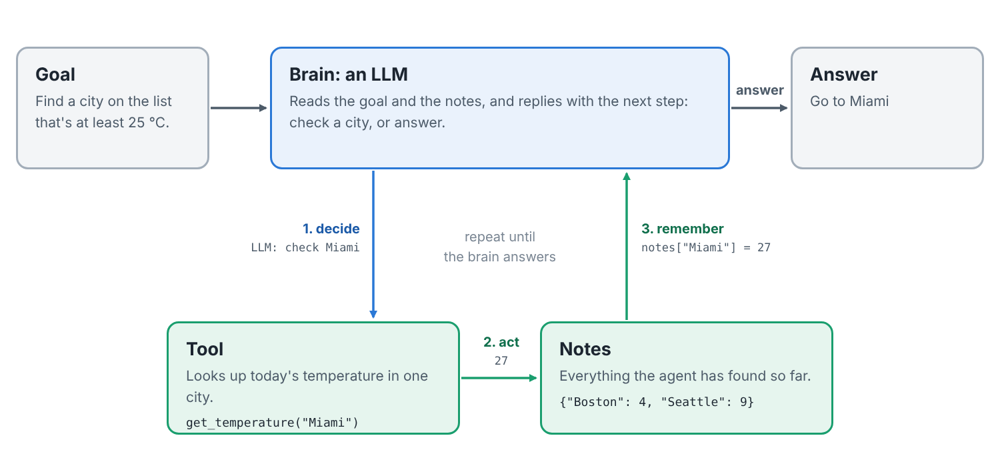

<div align="center">

<h1>Intro to AI Agents: Build the Simplest One</h1>

<p><em>A first look at AI agents: the simplest one there is, with an LLM as its brain, in about 20 lines of Python.<br>
Runs in Colab with its built-in LLM: free, no API key and no installs.</em></p>



<p><a href="https://colab.research.google.com/github/Mateiio/GenerativeShift/blob/main/presentations/ABRHSResearchClub/DataScienceTrack/Workshops/IntroToAgents/notebook/IntroToAgents_Workshop_ABRHS_ResearchClub.ipynb"></a> <a href="https://mateiio.github.io/GenerativeShift/presentations/ABRHSResearchClub/DataScienceTrack/Workshops/IntroToAgents/IntroToAgents_Workshop_ABRHS_ResearchClub.html"></a></p>

</div>

---

## Contents

| # | Section | Topic |
|---|---------|-------|
| 1 | [What is an agent?](#1-what-is-an-agent) | The goal, the four parts of an agent, and the LLM as its brain |
| 2 | [The agent](#2-the-agent) | The whole agent in one cell |
| 3 | [Try it yourself](#3-try-it-yourself) | Change it and watch what the LLM does |
| 4 | [What the LLM actually does](#4-what-the-llm-actually-does) | The model decides; code does the work |

> **Files in this folder**
>
> - `notebook/IntroToAgents_Workshop_ABRHS_ResearchClub.ipynb`: the notebook (runs in Colab)
> - `IntroToAgents_Workshop_ABRHS_ResearchClub.html`: a standalone version for reading or projecting ([view it online](https://mateiio.github.io/GenerativeShift/presentations/ABRHSResearchClub/DataScienceTrack/Workshops/IntroToAgents/IntroToAgents_Workshop_ABRHS_ResearchClub.html))
> - `IntroToAgents_README.md`: this file
> - `IntroToAgents_Workshop_Flier_ABRHS_ResearchClub.md`: the workshop flier
> - `assets/`: the agent loop diagram

---

## 1. What is an agent?

An agent works toward a goal in a loop. Ours has one goal: **find a city on our list that's at least 25 °C today.** It checks cities one at a time and decides after each one whether it's done. For that it needs four parts: a **tool**, a **brain**, **notes** and a **loop**. The brain is an **LLM**: each time around the loop, the agent asks it what to do next.

## 2. The agent

```python
from google.colab import ai         # Colab's built-in LLM: free, no API key

cities = ["Boston", "Seattle", "Miami", "Denver"]
temperatures = {"Boston": 4, "Seattle": 9, "Miami": 27, "Denver": -3}

def get_temperature(city):          # TOOL: looks something up
    return temperatures[city]

def brain(notes):                   # BRAIN: asks the LLM for the next step
    prompt = f"""Goal: find a city from {cities} that's at least 25 °C today.
Temperatures you've looked up so far: {notes}
If one of them is at least 25 °C, reply: answer CITY
Otherwise reply: check CITY, picking a city you haven't looked up yet.
Reply with exactly two words, like: check Boston"""
    reply = ai.generate_text(prompt).strip()   # the LLM call
    print("LLM:", reply)
    action, city = reply.split()
    return action, city

notes = {}                          # NOTES: what the agent has found so far
for step in range(10):              # LOOP: decide, act, remember (at most 10 LLM calls)
    action, city = brain(notes)
    if action == "answer":
        print("Go to", city)
        break
    notes[city] = get_temperature(city)
    print(city, "is", notes[city], "°C")
```

Each time around the loop, the agent makes one LLM call: it sends the goal and the notes, and the LLM replies with its decision, like `check Miami` or `answer Miami`. Everything else is plain Python.

| # | Part | In the code |
|---|---|---|
| 1 | Tool | `get_temperature` looks up one city |
| 2 | Brain | `brain` sends a prompt with the goal and the notes to the LLM and reads its two-word reply |
| 3 | Notes | `notes` remembers every temperature found so far |
| 4 | Loop | Asks the brain, uses the tool, updates the notes, and stops when the LLM answers or after 10 calls |

## 3. Try it yourself

- Run it a few times. Does the LLM always check the cities in the same order?
- Change 25 to 5 in the prompt. Where does it send you now?
- Add Phoenix at 31 °C. Which city does the LLM check first?

## 4. What the LLM actually does

The LLM never looks anything up. It only reads the prompt and writes two words back. The Python code runs the tool, keeps the notes and runs the loop. Every AI agent works this way, from this one to the ones behind ChatGPT and Claude: the model decides, and code does the work.

---

## Running the workshop

A suggested plan for about 25 minutes:

| # | Time | Section | Notes |
|---|---|---|---|
| 1 | 0:00 | 1. What is an agent? | Read the goal together; ask how a person would solve it |
| 2 | 0:05 | 2. The agent | Everyone runs the cell; compare what the LLM decided on different screens |
| 3 | 0:12 | 3. Try it yourself | Runs can differ, which makes a good discussion |
| 4 | 0:20 | 4. What the LLM actually does | Who does what in an agent, then questions |

- The notebook uses Colab's built-in LLM (`google.colab.ai`), so it only runs in Colab, and each student needs to be signed in to a Google account.

---

## Further reading

- Anthropic (2024). [Building effective agents](https://www.anthropic.com/research/building-effective-agents). When to use an agent, and the patterns real ones are built from.
- Yao et al. (2023). [ReAct: Synergizing Reasoning and Acting in Language Models](https://arxiv.org/abs/2210.03629). *ICLR.* The decide, act, observe loop with a language model as the brain.

---
*Tutorial produced as part of the ABRHS Research Club workshop series. The temperatures are invented for teaching.*
